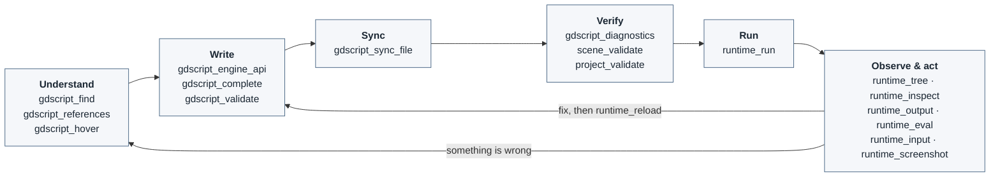
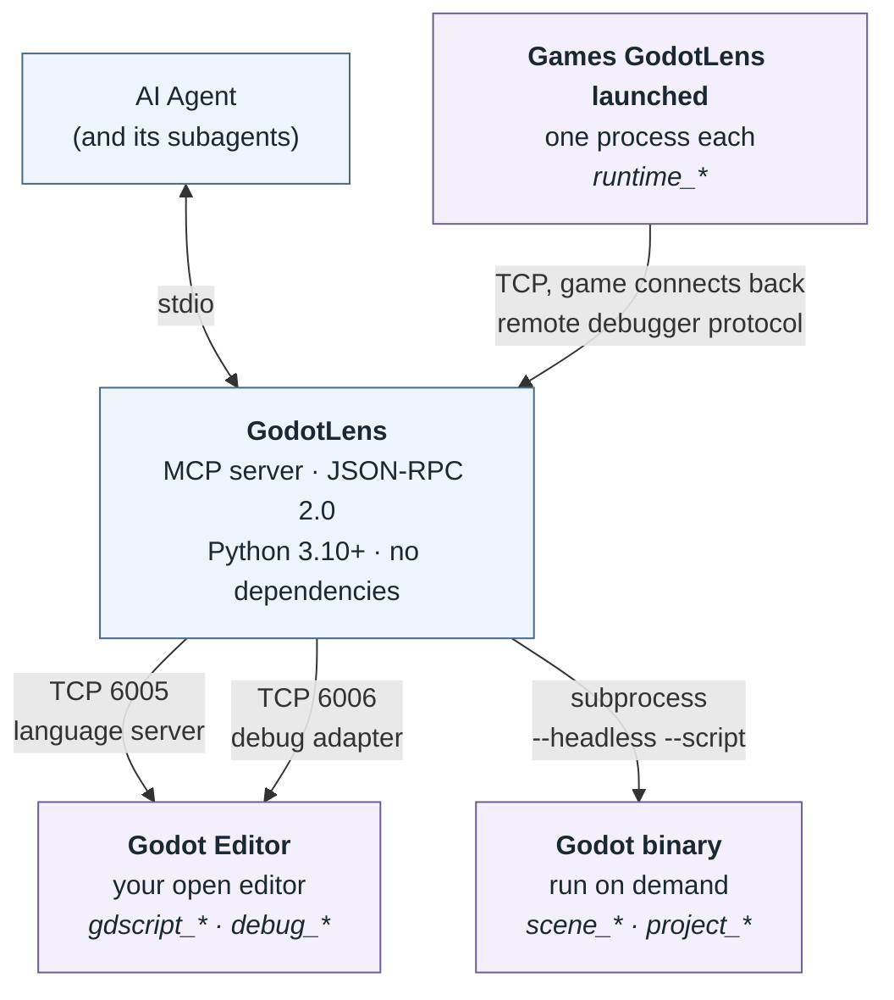

# GodotLens: Godot's own view of your GDScript project

[](https://github.com/pzalutski-pixel/godotlens-mcp/releases)
[](https://www.npmjs.com/package/godotlens-mcp)
[](https://pypi.org/project/godotlens-mcp/)
[](LICENSE)

An MCP server that lets an AI agent ask **Godot itself** about your project — where a symbol
is used, what a method's real signature is, whether an edit compiles, how a scene is wired —
and run the game, look at it and drive it, so the agent can check that the game does what it
meant without a person playing it.

## Why

An agent editing GDScript from text alone is guessing. It cannot tell a call from a comment,
cannot know which methods exist on a `CharacterBody2D` in *your* Godot version, cannot see that
a signal handler is wired by name inside a `.tscn`, and cannot see what happened at runtime.

GodotLens never answers those questions itself. It asks the engine and returns the engine's
answer. Measured on Godot 4.7.1, in a project where `take_damage` is defined in `player.gd`,
called twice from `enemy.gd`, once from `player.gd`, and named in a comment:

| Approach | Result |
|----------|--------|
| `grep take_damage` | 5 matches, including the comment |
| `gdscript_references` | exactly 4 real call sites; the comment is not among them |

That principle — *delegate every judgement to Godot* — is what makes the answers trustworthy,
and it is why the tool names tell you where an answer came from. `gdscript_*` is the language
server. `scene_*` and `project_*` run the engine on the project. `debug_*` is your editor's
debugger. `runtime_*` is a game GodotLens launched and is connected to.

## Requirements

| | Needed for |
|---|---|
| **Godot 4.6+** editor open on your project | `gdscript_*` and `debug_*` — the language server and debug adapter live inside the editor |
| A Godot **binary** via `GODOT_BIN`, a `./godot/` directory, or `PATH` | `scene_*`, `project_*` and `runtime_*`, which run the engine themselves and need no editor |
| **Python 3.10+**, or **Node.js 16+** for `npx` | running this server |

Godot 4.6 is the floor because the language server changed materially at 4.5 (URI encoding)
and 4.6 (document ownership). Older versions are refused with a clear message rather than
silently misread.

## Install

**npx** (recommended). The package bundles the server; there are no runtime dependencies.

```json
{
  "mcpServers": {
    "godotlens": {
      "command": "npx",
      "args": ["-y", "godotlens-mcp"]
    }
  }
}
```

**pip**

```bash
pip install godotlens-mcp
```

```json
{
  "mcpServers": {
    "godotlens": { "command": "godotlens-mcp" }
  }
}
```

## How to run

| Setup | What works | Do this |
|---|---|---|
| **Your editor is open** — normal development | Everything | Turn on **Import Resources When Unfocused** in Editor Settings (below). |
| **No editor** — CI, scripts | `scene_*`, `project_*`, `runtime_*` | For `gdscript_*` and `debug_*`, start a headless editor: `godot --path <project> --editor --headless --lsp-port 6005 --dap-port 6006` |
| **Games GodotLens launches** (`runtime_run`) | `runtime_*`, beside either of the above | Nothing. Each game is its own process connected to GodotLens; no editor run slot is used. |

**Import Resources When Unfocused.** The editor notices new and changed files only when its
window gains focus. An agent-driven editor never gains focus, so a new `class_name` script stays
unknown — every script using it reports the name as undeclared and the game fails to parse —
and new assets stay unimported. With this setting on, the editor rescans every half second.
It is `interface/editor/behavior/import_resources_when_unfocused` in 4.7 and
`interface/editor/import_resources_when_unfocused` in 4.6; to set it for one project only, put
the 4.6 name under `[editor_overrides]` in `project.godot` (4.7 migrates it on load). When a
synced file names a class the editor has not registered, `gdscript_sync_file` waits briefly,
then says which class and points here.

**Games GodotLens launches.** `runtime_run` starts the game with `--remote-debug` pointing at
GodotLens, so the game connects to GodotLens the way it would to the editor's debugger. Games
are **headless** by default — no window, no sound, nothing takes focus. Pass `windowed: true`
only for `runtime_screenshot`: the window opens at a far-off position with audio muted, and is
then moved fully off-screen, so at most a small corner may show for a moment.
Script errors are reported and never stop the game. A game started this way ends when it is
stopped, when GodotLens exits, and on Windows even if GodotLens is killed outright. Its log,
like that of every engine run GodotLens starts, goes to a temporary file of its own: Godot keeps
only the newest five logs per project, and your own play and test logs stay among them.

**The helper.** `runtime_eval` and `runtime_input` need code inside the game. GodotLens passes
its own `helper.gd` to the game with `--script` for that run only; **nothing is written to your
project**. Godot still loads your project's settings, input map and autoloads, and the helper
opens the scene. A project that sets its own main loop type runs without it, and
`runtime_run` with `helper: false` runs the game exactly as it is.

**Several agents.** Subagents in one Claude Code session share one GodotLens process
(`gdscript_status` and `runtime_status` report its `server_pid`). Calls run concurrently, so a
long `runtime_run` or scene check does not hold up anyone else's query, and each agent can run
its own game with `runtime_run` (`GODOT_RUNTIME_MAX_SESSIONS`, default 4). Two things are not
coordinated: `debug_run` uses your editor's single run slot, so a second run stops the first;
and two agents writing the same file overwrite each other — have one agent write at a time.

## The loop

The tools are designed around one cycle. Read it once and the rest of this document is a
reference.



1. **Understand.** `gdscript_find` locates a symbol by name; `gdscript_references` and
   `gdscript_hover` explain how it is used and what type it is.
2. **Write.** `gdscript_engine_api` gives real signatures instead of recalled ones,
   `gdscript_complete` offers scene-aware candidates, and `gdscript_validate` checks proposed
   content *before* it reaches disk.
3. **Sync.** Godot's language server does not watch the filesystem. After editing a `.gd`
   file, call `gdscript_sync_file` or it keeps answering from the old text.
4. **Verify.** `gdscript_diagnostics` for compile errors, `scene_validate` for what the
   compiler cannot see in a scene, `project_validate` after moving files.
5. **Run.** `runtime_run` starts the game and returns its first output and errors.
6. **Observe and act.** See the live tree and values, press inputs, evaluate expressions,
   take a screenshot; fix the code and `runtime_reload` it into the running game.

Two conventions apply throughout:

- **All line and character parameters are 0-indexed**, matching the LSP. Editor line 1 is
  line 0. `gdscript_find` exists partly so you rarely have to compute one by hand.
- **Results carry a `verified` flag** where it matters. `verified: false` with an empty
  diagnostics list means Godot never reported back — that is *not* a clean bill of health.

## Tools

### Understanding code

| Tool | Description |
|------|-------------|
| `gdscript_find` | Locate a declaration **by name**. Returns a position the tools below accept directly. |
| `gdscript_definition` | Where a symbol is defined. |
| `gdscript_references` | Every reference project-wide. On 4.6+ this reparses every `.gd` file, so it is not cheap. |
| `gdscript_references_in_file` | Occurrences within one file. Much cheaper. Godot 4.7+. |
| `gdscript_hover` | Type information and documentation for a symbol. |
| `gdscript_symbols` | The symbol tree of a file. |
| `gdscript_signature_help` | Parameter info at a call site. |
| `gdscript_symbols_batch`, `gdscript_definitions_batch`, `gdscript_references_batch` | The same, across many files or positions in one call. |

### Writing code

| Tool | Description |
|------|-------------|
| `gdscript_engine_api` | Signatures and docs for an engine class or member, from the exact build in use, including members inherited from parent classes. Use instead of recalling Godot's API. |
| `gdscript_complete` | Completions at a position. The only **scene-aware** query: includes real `$NodePath` entries and the signals actually on the owning node. |
| `gdscript_validate` | Check proposed content for errors **without writing it to disk**. |
| `gdscript_rename` | Rename a symbol. Refuses when Godot will not rename it, and warns when the name also appears in scene files it cannot update. |

### Keeping Godot in step

| Tool | Description |
|------|-------------|
| `gdscript_sync_file` | Sync one modified file and return its diagnostics. Waits briefly for a new `class_name` the editor has not registered yet. |
| `gdscript_sync_files` | Sync several at once. |
| `gdscript_release_file` | Release a file so the language server reads from disk again. |
| `gdscript_diagnostics` | Errors and warnings for one or more files. |
| `gdscript_status` | Connection check. Start here if anything behaves oddly. |

### Project and scenes

These run the Godot binary, so scenes resolve exactly as the engine builds them, inherited and
instanced scenes included. They do not parse `.tscn` as text, and need no editor.

| Tool | Description |
|------|-------------|
| `project_config` | Autoload singletons, input action names, `class_name` globals, and the main scene, via `ProjectSettings`, with whether each file exists. |
| `project_validate` | References that no longer resolve after files move: scene and resource dependencies, autoload scripts, the main scene. A reference whose UID still resolves is not broken. |
| `scene_state` | Node tree, types, script attachments, `unique_name_in_owner` flags, exported values, and signal connections. |
| `scene_validate` | What Godot gets silently wrong in a scene. Errors: dangling connections, missing signals, handlers taking the wrong number of arguments, unknown node types, scripts that do not fit their node, missing parents, duplicate names. Warnings: unknown properties, wrong value types, NodePaths to nodes not in the scene. |

### Debugger in your editor

Godot serves a Debug Adapter Protocol server from the editor, no addon required. These use
the editor's own run slot — one game at a time — and are the way to set breakpoints.

| Tool | Description |
|------|-------------|
| `debug_run` | Run the project from the editor and return what it printed and every structured error. `args: ["--headless"]` runs it with no window. |
| `debug_output` | Output from that game — `print`, stdout, stderr — and structured errors (`push_error`, `push_warning`, engine and script errors) with file, line and stack. Drained on each call. |
| `debug_set_breakpoints` | Set breakpoints in a file. |
| `debug_stack_trace` | The call stack where execution is paused. Empty means not paused. |
| `debug_inspect` | Variables in a stack frame, by scope. |
| `debug_evaluate` | Evaluate an expression at a breakpoint. Refused where Godot would resume the game instead of answering. |
| `debug_continue`, `debug_pause`, `debug_step_over` | Execution control. |
| `debug_terminate` | Stop the running game. |
| `debug_status` | Adapter connection and whether the game is running or paused. |

### Games GodotLens launches

`runtime_run` starts the game as its own process, connected straight back to GodotLens, so
several agents can each run one at once and no editor is needed.

| Tool | Description |
|------|-------------|
| `runtime_run` | Launch the game, headless by default. Returns a session id and its first output and errors. |
| `runtime_output` | What the game printed and every structured error it raised, with file, line and stack. |
| `runtime_tree` | The live scene tree, including nodes created at runtime. |
| `runtime_inspect` | Current property values of a node, script variables included. |
| `runtime_set` | Change a property and read it back; values are converted to the property's type. |
| `runtime_eval` | Evaluate an expression while the game runs, against the scene, autoloads, engine singletons and `class_name` globals. |
| `runtime_input` | Press an input action as a player would; `is_action_just_pressed` sees it. |
| `runtime_reload` | Hot-reload changed scripts, keeping state. Refuses scripts that do not compile. |
| `runtime_screenshot` | What a windowed game is drawing, as an image. |
| `runtime_monitors` | FPS, frame times, node and orphan counts, memory, custom monitors, with history. |
| `runtime_pause`, `runtime_time_scale`, `runtime_step` | Freeze, slow down, or step a game. |
| `runtime_status`, `runtime_stop` | List and stop the games GodotLens is running. |

## Limitations

Worth knowing before you trust a result.

**What the language server cannot see**

- **It reads `.gd` files only.** A signal handler wired in a `.tscn` `[connection]` block is
  invisible to it, so renaming that handler leaves the scene pointing at a method that no longer
  exists. This is why `scene_validate` exists and why `gdscript_rename` warns.
- **Autoload and input action names are bare strings.** `GameState.add_score(1)` and
  `Input.is_action_pressed("jump")` are validated by nothing at all. Check them against
  `project_config` before writing them.
- **New files reach it only through the editor's filesystem scan** (see *How to run*). The
  scan notices a folder only when its modification time changes, and Godot keeps those times
  in whole seconds, so a file created in the same second as a scan can be missed. When a new
  class is still unknown a second later, GodotLens creates and removes an empty hidden file
  (`.godotlens-rescan`) in that folder — the editor ignores dot-names — so the next scan
  re-reads it. Nothing else is written to your project.
- **`gdscript_references` is expensive on 4.6+**, reparsing every script in the project.
  Prefer `gdscript_references_in_file` when one file is enough.

**Running games**

- **No pixels in a headless game.** `runtime_screenshot` needs `windowed: true`, and
  `runtime_step` does too: Godot pauses again only after the next *drawn* frame.
- **Hot reload covers scripts only.** Edited `.tscn` files and new or changed assets need a
  restart. A script that fails to compile is disabled in the running game, so `runtime_reload`
  refuses one with errors — which needs the editor's language server to check; without an
  editor it reloads unchecked and says so.
- **`runtime_eval` is Godot's `Expression`, not full GDScript**: calls, operators and member
  access, no statements or assignment. Calls run for real.
- **Breakpoints are only in your editor** (`debug_*`). `debug_evaluate` works only while paused
  in a frame with a script instance; in a static function or at a parse-error break it is
  refused, because Godot would resume the game instead of answering.
- **Godot rate-limits what a game reports** (`network/limits/debugger/*` project settings): a
  game printing heavily has its output truncated by the engine.
- **On Linux and macOS** a game is stopped when GodotLens exits normally, but keeps running if
  GodotLens is killed outright. On Windows it is stopped either way (a job object).

**Scene and project checks**

- **`scene_*` and `project_config` start your autoloads**, as the game would, so a script that
  uses an autoload compiles. `project_validate` and `runtime_monitors` start nothing.
- **Some scene mistakes are not visible to any engine API.** An unknown property on a
  `[sub_resource]` is dropped by Godot while loading, before anything can ask about it.
- **`project_validate` covers scenes and resources.** A broken `preload()` or `extends` path in a
  script is a compile error, which `gdscript_diagnostics` reports.

**One project, one editor.** A second editor on the same project — a headless one beside your
GUI editor, say — rewrites `.godot/`'s class cache from its own view and can drop classes the
other registered. Attach GodotLens to the editor you have open.

## Architecture

Four channels, one process. Each tool group maps to exactly one of them, which is how you know
where an answer came from.



The MCP, LSP and DAP protocols and Godot's binary value format are implemented directly against
the standard library, so the package has **zero runtime dependencies** and the npm bundle is a
handful of `.py` and `.gd` files.

## Configuration

| Variable | Default | Description |
|---|---|---|
| `GODOT_LSP_HOST` | `127.0.0.1` | Language server host |
| `GODOT_LSP_PORT` | `6005` | Language server port. The official VS Code extension uses `6008` |
| `GODOT_DAP_HOST` | `127.0.0.1` | Debug adapter host |
| `GODOT_DAP_PORT` | `6006` | Debug adapter port, used by `debug_*` |
| `GODOT_BIN` | auto | Godot executable, required by `scene_*`, `project_*` and `runtime_*` |
| `GODOT_PROJECT_ROOT` | auto | Project root; auto-detected by walking up for `project.godot` |
| `GODOT_LSP_TIMEOUT` | `15` | Seconds to wait for a single language server response |
| `GODOT_DIAGNOSTICS_TIMEOUT` | `8` | Seconds to wait for diagnostics after a sync |
| `GODOT_VERSION` | auto | Override capability detection |
| `GODOT_FIND_FILE_LIMIT` | `60` | Max files `gdscript_find` inspects when searching the whole project |
| `GODOT_RUNTIME_MAX_SESSIONS` | `4` | Max games `runtime_run` keeps running at once |

## Contributing

```bash
pip install -e ".[dev]"
pytest -m "not integration"   # no Godot needed
ruff check .
```

Integration tests launch a real headless Godot and skip cleanly without one. The one test that
opens a game window runs only when asked, or under a virtual display on Linux:

```bash
GODOT_BIN=/path/to/godot pytest -m integration
GODOTLENS_WINDOWED_TESTS=1 GODOT_BIN=/path/to/godot pytest -m windowed
```

CI runs the suite on Linux, Windows and macOS across Python 3.10–3.13, runs the integration
tests against a real Godot on all three, and installs the built npm tarball and executes it.

## License

Apache License 2.0 — see [LICENSE](LICENSE) and [NOTICE](NOTICE).

<!-- mcp-name: io.github.pzalutski-pixel/godotlens -->
